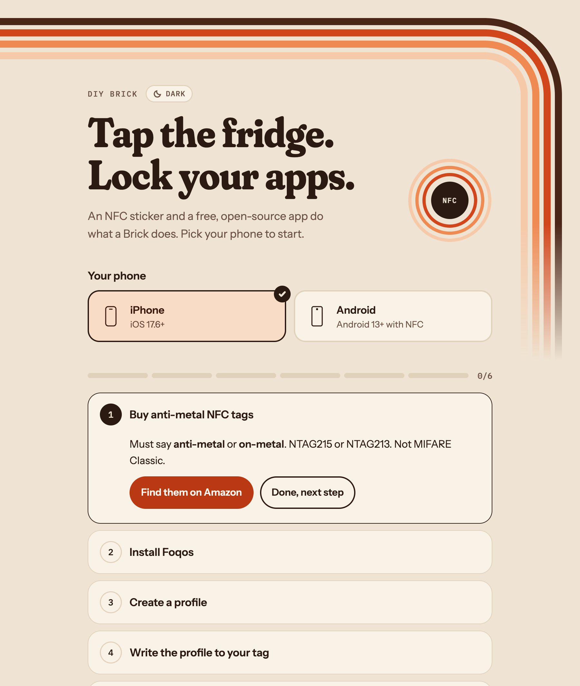

# Tapout

Build your own [Brick](https://getbrick.com) with one NFC sticker and a free, open-source app. Tap your phone on the fridge to lock your distracting apps, and walk back to the fridge to unlock them.

**→ [Open the setup wizard](https://lebotomy.github.io/tapout/)**

| Phone | App | Source |
|---|---|---|
| iPhone, iOS 17.6+ | [Foqos](https://apps.apple.com/app/foqos/id6736793117) (free) | [awaseem/foqos](https://github.com/awaseem/foqos) |
| Android 13+ with NFC | [Lock](https://play.google.com/store/apps/details?id=com.nathanb.lock) (free) | [NathanLenias/lock-app](https://github.com/NathanLenias/lock-app) |

## What to buy

[Anti-metal NFC tags on Amazon](https://www.amazon.com/s?k=anti-metal+NFC+tag+NTAG215+25mm). Must say **anti-metal** or **on-metal**. NTAG215 or NTAG213. Not MIFARE Classic.

For magnets, keychains, and other builds, see [ideas.md](ideas.md).

---

Fixes and photos of your setup are welcome as issues or PRs. Not affiliated with Brick, Foqos, or Lock. MIT licensed.
